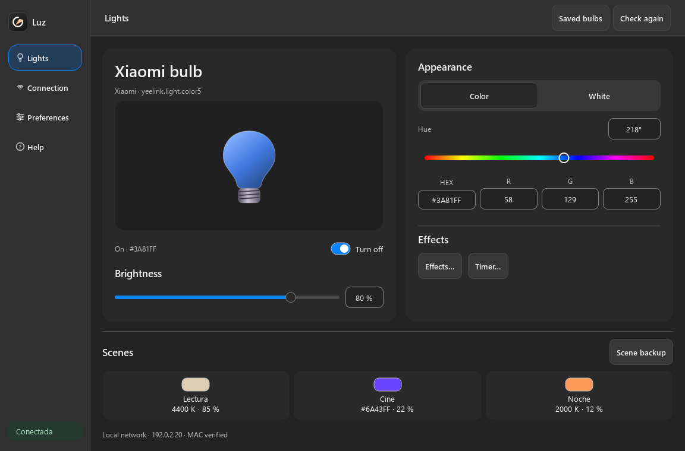
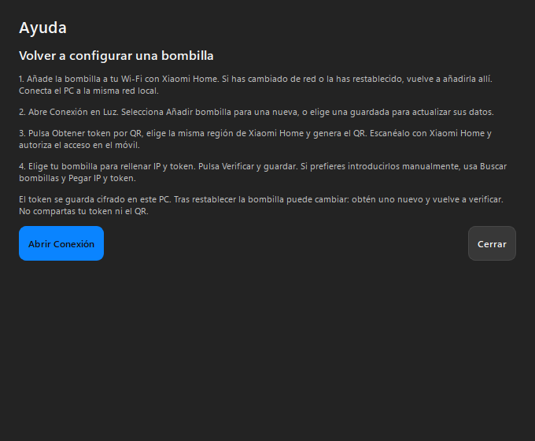

  
  <h1>Luz</h1>
  
Una aplicación de escritorio para controlar bombillas Xiaomi desde Windows.

  
<strong>Control local · Escenas guardadas · Atajos globales · Español e inglés</strong>

  
<a href="README.md">English</a> · <a href="README.es.md">Español</a> · <a href="https://github.com/adamrz5/Luz/releases/latest">Descargar para Windows</a>

  <a href="#primeros-pasos">Empezar</a> ·
  <a href="#bombillas-compatibles">Compatibilidad</a> ·
  <a href="#desarrollo">Desarrollo</a> ·
  <a href="#compilación-y-firma">Compilar y firmar</a>

Luz controla bombillas Wi-Fi Xiaomi y Yeelight compatibles mediante miIO en la red local. Permite ajustar color, temperatura de blanco y brillo, guardar tres escenas y utilizar atajos de Windows mientras permanece junto al reloj.

El dispositivo probado físicamente es la **Xiaomi Mi Smart LED Bulb Essential, MJDPL01YL**, identificada como **yeelink.light.color5**. Los demás modelos del catálogo cuentan con referencias del controlador o pruebas simuladas.

## Funciones

La guía sigue disponible en **Conexión**, aunque ya tengas una bombilla guardada. Para configurar otra, selecciona **Añadir bombilla**, sigue **Obtener token por QR** y pulsa **Verificar y guardar**. Las bombillas guardadas se conservan.

- **Controles precisos** con barra de tono, valores HEX/RGB, temperatura de blanco y brillo exacto.
- **Vista previa inmediata** al arrastrar. Un clic en la bombilla dibujada enciende o apaga la luz.
- **Tres escenas** con edición conjunta de color y brillo, cambio de nombre, vaciado, importación y exportación.
- **Bombillas y habitaciones guardadas**, con aplicación del color o blanco a una habitación o a todos los perfiles.
- **Atajos globales** con información sobre la última pulsación y si la orden está pendiente, aplicada o ha fallado.
- **Control desde la bandeja de Windows** para encendido y escenas, inicio opcional con Windows y comprobaciones silenciosas de conexión aproximadamente cada minuto.
- **Temas claro y oscuro**, e interfaz en español e inglés.

Luz consulta el estado tras cambiar encendido, brillo, color, blanco o escena. Si la bombilla no confirma el resultado esperado, informa de que el cambio no se aplicó. Las órdenes compatibles de la bandeja pueden reintentar una conexión perdida.

## Primeros pasos

### Instalar en Windows

Descarga **[Luz 1.0.0 para Windows x64](https://github.com/adamrz5/Luz/releases/download/v1.0.0/Luz-1.0.0-Windows-x64.exe)** desde [Releases](https://github.com/adamrz5/Luz/releases/latest). Ejecuta el instalador; no necesitas instalar Python. Se instala para el usuario actual y crea un acceso en el menú Inicio. Requiere Windows 10 versión 1809 o posterior.

**El instalador no tiene firma digital.** Windows puede mostrar un aviso de editor desconocido o SmartScreen. Antes de ejecutarlo, compara su SHA-256 con `SHA256SUMS.txt` de la misma versión. Para generar tu propia compilación, consulta [Compilación y firma](#compilación-y-firma).

El repositorio contiene código, pruebas, recetas de compilación y documentación. Excluye datos personales, entornos virtuales, compilaciones generadas y resultados de auditorías locales. Una copia de desarrollo puede tener un `app/Luz.exe` local ignorado por Git; su carpeta `_internal` debe permanecer al lado.

### Conectar una bombilla

Luz abre automáticamente una pantalla de **Conexión** guiada cuando no hay token guardado. Explica cómo buscar la bombilla, conseguir y pegar su token y verificar la conexión. **Configurar más tarde** permite salir sin guardar. Una vez configurado el token, la aplicación abre normalmente; una bombilla sin conexión no vuelve a iniciar la guía.

La guía respeta los formularios ya abiertos, impide salir de una verificación en curso mediante la navegación o Escape, libera el diálogo QR al cerrarlo y cancela su trabajador de nube. No empieza ninguna conexión con Xiaomi hasta pulsar Generar QR.

**Primera apertura, sin credenciales guardadas.** Es una captura real en Windows con un perfil temporal vacío. La ventana está ampliada para mostrar el formulario completo; en ventanas pequeñas el contenido se desplaza verticalmente.

**Obtener token por QR** abre el asistente integrado. Reutiliza el extractor comunitario incluido, muestra el QR dentro de Luz y busca bombillas compatibles después de autorizar con Xiaomi Home. No necesitas otro ejecutable, navegador ni servidor web local.

1. Añade la bombilla a tu Wi-Fi mediante Xiaomi Home.
2. Abre **Conexión** en Luz.
3. Pulsa **Obtener token por QR**, elige la misma región que en Xiaomi Home y pulsa **Generar QR**.
4. Escanea el QR con Xiaomi Home y confirma el acceso en el móvil.
5. Elige una bombilla compatible. Luz rellena su IP, token enmascarado y nombre de Xiaomi Home.
6. Revisa la IP y pulsa **Verificar y guardar**. Puedes añadir una etiqueta local y una habitación.

Se mantienen la entrada manual, el pegado de IP/token y la búsqueda local. Si una bombilla no tiene IP local o utiliza un protocolo no compatible, no aparece en los resultados QR.

La búsqueda encuentra dispositivos candidatos. Para guardar un perfil es necesario autenticar y comprobar su identidad y estado.

El adaptador QR reutiliza [Xiaomi Cloud Tokens Extractor](https://github.com/PiotrMachowski/Xiaomi-cloud-tokens-extractor). Su módulo se carga bajo demanda sin interpretar los argumentos de Luz, abrir una terminal ni iniciar el servidor HTTP del extractor. Un trabajador independiente y cancelable realiza las peticiones HTTPS; el arranque normal y las órdenes locales de iluminación no dependen de él.

La sesión QR, las cookies de la cuenta y las credenciales de nube permanecen en memoria y se descartan al finalizar el trabajador. Solo se guarda el token de la bombilla elegida, cifrado con DPAPI, después de la comprobación local de identidad y estado. Cancelar cierra el diálogo inmediatamente; una petición HTTPS que ya esté en curso termina según sus tiempos de espera. Es una integración comunitaria con los servicios de Xiaomi: las políticas de cuenta y los cambios del servidor pueden afectar al acceso.

El CLI independiente sigue disponible mediante `tools/Obtener-Token.cmd` para desarrollo, pero el usuario normal no necesita descargarlo ni ejecutarlo aparte.

La etiqueta local solo afecta a Luz. El campo del nombre en Xiaomi Home guarda un nombre copiado o importado; no cambia el nombre en Xiaomi Home.

### Uso diario

| Acción | Atajo predeterminado |
| --- | --- |
| Encender o apagar | Ctrl + Alt + F5 |
| Aplicar escena 1 / 2 / 3 | Ctrl + Alt + F6 / F7 / F8 |
| Subir / bajar brillo | Ctrl + Alt + 8 / 9 |
| Subir / bajar temperatura de blanco | Ctrl + Alt + F9 / F10 |
| Activar o salir de pantalla completa | F11 |
| Salir de pantalla completa o cancelar la edición de escena | Esc |

Los atajos de brillo utilizan la fila superior de números. Los atajos personalizados que contienen Num requieren teclado numérico. Puedes cambiar las combinaciones en **Preferencias** si otra aplicación las utiliza.

Haz clic derecho en una escena y selecciona **Editar escena** para modificar color o blanco y brillo. **Guardar escena** guarda y aplica el borrador. **Cancelar** lo descarta. **Vaciar** restablece la escena como Blanco, a 4000 K y 100 % de brillo, después de confirmarlo.

Al cerrar, Luz permanece en la bandeja si esa preferencia está activada. Selecciona **Salir** en su menú para detenerla. Después de guardar un cambio de idioma, el siguiente cierre termina el proceso para que el nuevo idioma se cargue al abrirla otra vez.

### Atajos y guía de configuración

En **Ayuda** encontrarás dos entradas separadas: **Atajos**, con tus combinaciones guardadas y su estado, y **Ayuda**, con una guía breve para añadir o volver a configurar una bombilla. La guía explica Xiaomi Home, Wi-Fi, región, QR, IP, token y **Verificar y guardar**. Pulsa **Abrir Conexión** para seguir los pasos sin borrar las bombillas guardadas. Ambos apartados están traducidos al español y al inglés y usan el idioma elegido en Preferencias.

## Bombillas compatibles

Los sufijos de la tabla corresponden a `yeelink.light.`.

| Sufijo | Controles | Validación |
| --- | --- | --- |
| `color5` | Encendido, brillo, RGB, blanco regulable, efectos seleccionados y temporizador | MJDPL01YL probada físicamente |
| `color`, `color1`, `color2`, `color3`, `color4`, `color7`, `colorc` | Encendido, brillo, RGB y blanco regulable | Especificaciones del controlador y pruebas simuladas |
| `ct_bulb`, `ct2` | Encendido, brillo y blanco regulable | Especificaciones del controlador y pruebas simuladas |
| `mono1`, `mono5`, `monob` | Encendido y brillo | Especificaciones del controlador y pruebas simuladas |

**Ayuda → Modelos compatibles** muestra el catálogo y la evidencia disponible. La compatibilidad depende del firmware y del acceso a la red local. Las bombillas Bluetooth, Zigbee, Matter o dependientes de una pasarela necesitan otros protocolos.

La Essential probada responde mediante miIO. Tres intentos de conexión Yeelight TCP agotaron su tiempo de espera mientras las lecturas miIO autenticadas funcionaban. La compatibilidad Yeelight LAN sigue sin confirmarse para esa configuración.

## Privacidad y datos

- Los tokens se cifran con **Windows DPAPI** para el usuario actual. Los perfiles actuales vinculan además el cifrado a la MAC y al modelo de la bombilla.
- Los perfiles y las escenas se validan y guardan mediante reemplazos atómicos.
- Los dispositivos descubiertos se autentican antes de adoptarse.
- Un hilo de trabajo procesa las órdenes de red en serie y agrupa cambios consecutivos del deslizador.
- Las comprobaciones en segundo plano utilizan un temporizador de aproximadamente un minuto. Si el estado no cambia, conservan la información visible y evitan actualizar de nuevo los controles.
- Los registros de diagnóstico tienen tamaño limitado y eventos predefinidos. Las exportaciones omiten identificadores de red; revísalas antes de compartirlas.
- Las copias de escenas contienen sus nombres y valores.

miIO utiliza un token compartido y no ofrece TLS. Luz comprueba origen, identidad, identificador de petición y marca de tiempo. Estas comprobaciones no modifican la protección del firmware contra repeticiones. La importación limpia el portapapeles actual, pero el historial o la sincronización de Windows pueden conservar una copia anterior.

| Ubicación | Función |
| --- | --- |
| `config/` | Datos de la copia de desarrollo y su `app/` adyacente |
| `%LOCALAPPDATA%/Luz` | Datos de las compilaciones distribuidas o instaladas por separado |
| `LUZ_STATE_DIR` | Ruta absoluta alternativa para pruebas aisladas |

Los datos incluyen `bombilla.json`, `escenas.json`, `preferencias.ini`, registros limitados y archivos de bloqueo de instancia. Se mantiene compatibilidad con los archivos antiguos `bombilla-token.dpapi` y `bombilla-ip.txt`.

Las credenciales DPAPI pertenecen al usuario de Windows que las guardó. Si reinstalas Windows, introduce de nuevo el token e importa una copia de escenas si la tienes. La desinstalación conserva los datos del usuario.

## Desarrollo

Utiliza Windows x64 y Python 3.11. Las versiones de las dependencias están fijadas en [requirements.txt](requirements.txt).

~~~powershell
py -3.11 -m venv .venv
.\.venv\Scripts\python.exe -m pip install -r requirements.txt
.\.venv\Scripts\pythonw.exe src/Bombilla.pyw
~~~

### Pruebas

~~~powershell
.\.venv\Scripts\python.exe -B tests/ejecutar-seguras.py
~~~

Las 25 suites seguras utilizan directorios temporales, Qt sin ventana visible y conexiones Python limitadas a la interfaz local de pruebas. Cubren la primera configuración guiada, DPAPI, formatos antiguos, perfiles, escenas, distribución visual, atajos, descubrimiento, validación de paquetes, entradas incorrectas, escritura atómica y recuperación.

Las pruebas de fallos incluyen respuestas retrasadas, identidad incorrecta, tokens inválidos, mensajes antiguos, confirmaciones perdidas y una bombilla simulada que acepta una orden de brillo sin aplicarla.

La [integración continua de Windows](.github/workflows/ci.yml) ejecuta las suites, compila el instalador y comprueba instalación, apertura de la ventana nativa, cierre normal y desinstalación. Las pruebas usan datos aislados y no necesitan una bombilla real ni una cuenta Xiaomi. Las mediciones locales, los generadores de capturas y los guiones específicos de pruebas físicas no forman parte del código público.

### Arquitectura

| Componente | Responsabilidad |
| --- | --- |
| [Bombilla.pyw](src/Bombilla.pyw) | Interfaz Qt, vista previa, borradores de escenas, cola de órdenes y coordinación del trabajador |
| [BombillaLocal.py](src/BombillaLocal.py) | Transporte miIO, identidad, capacidades, perfiles, DPAPI y recuperación de IP |
| [Escritorio.py](src/Escritorio.py) | Preferencias, atajos de Windows e inicio automático |
| [Escenas.py](src/Escenas.py) | Validación de escenas, copias y guardado atómico |
| [Diagnostico.py](src/Diagnostico.py) | Registro limitado y exportaciones sin datos sensibles |
| [XiaomiCloud.py](src/XiaomiCloud.py) | Adaptador del extractor bajo demanda, HTTPS limitado, cancelación y filtrado de bombillas |
| [TokenXiaomi.py](src/TokenXiaomi.py) | Asistente QR nativo, resultados temporales y selección |
| [Idioma.py](src/Idioma.py) | Textos originales en español y traducciones al inglés |
| [Tema.py](src/Tema.py) | Colores, tipografía, foco, movimiento y apariencia en Windows |
| [build/](build/) | Receta de PyInstaller, instalador de Inno Setup e icono |
| [tools/](tools/) | Control por consola, diagnóstico, extractor de tokens y herramientas de publicación |
| [tests/](tests/) | Suites de regresión aisladas y comprobación del ejecutable empaquetado |
| [assets/](assets/) | Identidad visual y captura del producto |

El estado confirmado de la bombilla, la vista previa inmediata y las escenas guardadas son valores distintos. La edición actualiza la vista previa al momento. El trabajador de red devuelve el estado mediante señales de Qt. Cada bombilla añadida aprende su propio identificador autenticado de dispositivo.

### Contribuir e informar de problemas

Mantén los cambios centrados en un problema y ejecuta las suites seguras. Indica modelo de bombilla, versión de Windows, pasos para reproducir el problema y comportamiento esperado. Si resulta útil, adjunta un diagnóstico revisado y sin datos sensibles. No incluyas tokens, credenciales de cuenta ni datos personales en incidencias o commits.

## Compilación y firma

Instala **Inno Setup 6** para el usuario actual de Windows. Ejecuta desde PowerShell:

~~~powershell
.\tools\Build-Release.ps1
~~~

El proceso ejecuta las suites seguras, empaqueta y comprueba la aplicación, compila el instalador y genera su suma SHA-256.

| Ruta generada | Contenido |
| --- | --- |
| `build/ensayo/app/` | Aplicación y bibliotecas de Qt |
| `build/distribucion/Luz-instalador.exe` | Instalador de Windows |
| `build/distribucion/SHA256SUMS.txt` | Suma de comprobación del instalador |
| `build/cache/` | Archivos temporales regenerables de PyInstaller |

Los resultados generados se excluyen de Git. El ejecutable local de uso habitual permanece en `app/Luz.exe` si existe en tu copia de desarrollo.

### Firma reconocida por Windows

Para firmar una versión se necesitan las herramientas de firma del SDK de Windows y un certificado de firma de código vigente y de confianza, con clave privada en el almacén del usuario actual.

~~~powershell
.\tools\Build-Release.ps1 -CertificateThumbprint HUELLA_DEL_CERTIFICADO
~~~

Esto firma la aplicación, el instalador, el desinstalador y las copias internas de Inno Setup utilizando SHA-256 y sellado de tiempo. Los certificados privados se excluyen de Git. La herramienta rechaza certificados autofirmados, caducados o sin confianza.

Un certificado autofirmado no verifica el editor en otro ordenador. Una firma válida tampoco garantiza reputación inmediata en SmartScreen. Consulta la [documentación de Microsoft](https://learn.microsoft.com/en-us/windows/apps/package-and-deploy/smartscreen-reputation).

La versión 1.0.0 no está firmada. La firma de distribución queda pendiente de disponer de un certificado de confianza.

### Compilación portable

~~~powershell
.\.venv\Scripts\python.exe -m PyInstaller --noconfirm build/Luz.spec --distpath build/distribucion --workpath build/cache-portatil -- --portatil
~~~

La edición de un solo archivo extrae sus bibliotecas a un directorio temporal. Para distribuir la compilación habitual, conserva su carpeta de aplicación completa.

## Validación automática del instalador

GitHub Actions compila la aplicación y el instalador de Inno Setup en el trabajo `verify`. Otro runner de Windows descarga ese instalador, verifica su SHA-256, lo instala, espera a que aparezca la ventana de Luz, la cierra normalmente y desinstala la aplicación. La ejecución utiliza un directorio de datos vacío y elimina Python del `PATH`. El instalador y el informe JSON quedan como artefactos del flujo.

La validación de publicación incluye 25 suites seguras y comprobaciones independientes del instalador. También se verificó localmente el SHA-256 del archivo descargado. Las ejecuciones públicas actuales están en [Actions](https://github.com/adamrz5/Luz/actions).

La imagen de Windows del runner contiene software preinstalado. Esta comprobación valida una instalación independiente sin las dependencias del proyecto, pero no sustituye una prueba en un Windows completamente limpio. Los artefactos no contienen perfiles de bombillas ni tokens guardados.

El extractor incluido limita el tiempo de espera de todas sus peticiones HTTP. Los fallos al consultar el QR terminan correctamente tras una espera agotada, error de conexión o respuesta HTTP fallida, sin una excepción por variable inexistente ni reintentos ilimitados. Las pruebas usan respuestas sintéticas, sin cuenta Xiaomi.

Las rutas alternativas de datos se normalizan para que los nombres abreviados de Windows y sus rutas resueltas identifiquen el mismo directorio.

La exportación de diagnósticos rechaza los archivos de credenciales, perfiles, preferencias y el bloqueo de instancia del escritorio. Una prueba de regresión verifica que no puede sobrescribir ese bloqueo.

### Revisión y nueva validación de la primera configuración

Las ejecuciones de compilación, pruebas y validación del instalador están disponibles en [GitHub Actions](https://github.com/adamrz5/Luz/actions).

Se revisaron los flujos y sus llamadas: arranque diferido, navegación y Escape, formulario guiado, respuestas de la verificación, vida de la ayuda QR, traducciones, pruebas y valores de versión. La versión 1.0.0 añade el trabajador y el diálogo QR integrados, manteniendo la verificación local y las protecciones del asistente anterior.

| Caso | Comportamiento comprobado |
| --- | --- |
| Perfil vacío, español / inglés | Se abre una sola guía traducida y el token aparece enmascarado |
| Importación del portapapeles | Se pegan IP, token y nombre copiado, y se limpia el portapapeles importado |
| Validación incorrecta o fallida | El formulario permanece abierto y conserva los datos para reintentar |
| Verificación correcta | Se adoptan la bombilla y el token y se cierra la guía |
| Configurar más tarde / token existente | Se puede salir sin guardar; un token existente evita la guía automática |
| Inicio oculto / cierre / otra página abierta | La bienvenida no interrumpe esos estados |
| Navegación o Escape durante la verificación | El formulario pendiente sigue abierto y la selección del menú permanece correcta |
| QR integrado | Sin red al abrir el diálogo; generación, límites de imagen, cancelación, selección bilingüe e importación de campos probados con respuestas sintéticas |
| Sesión de nube | Comprobados HTTPS, dominios, redirecciones, tamaño de respuesta, filtrado de modelos, errores sin secretos y limpieza de cookies |

La batería segura completa contiene 25 suites. Las capturas usan Qt nativo de Windows, datos temporales vacíos y ninguna credencial real de bombilla. También se comprobó que el tamaño mínimo de ventana no provoca desbordamiento horizontal. También se ha comprobado la generación real del QR sin autenticar y su cancelación. La aprobación móvil con una cuenta real y la recuperación de sus bombillas quedan pendientes: el usuario no pudo completar ese paso durante la validación. Las capturas nunca contienen un QR de autorización activo. La instalación en un Windows completamente limpio sigue siendo una limitación independiente.

## Validación y límites

La Essential se ha utilizado para comprobar encendido, brillo, RGB, temperatura de blanco, atajos, un efecto seleccionado, clics en la vista previa y órdenes rápidas combinadas. Con 200 ms de retraso añadido, los cambios de brillo y color seguidos de apagado alcanzaron el estado final esperado.

Los fallos de comunicación inyectados en el controlador se recuperaron mediante lecturas autenticadas. Las sesiones físicas restauraron el encendido, brillo y color iniciales.

Pendiente de validar:

- Instalación y arranque en un Windows completamente limpio.
- Recuperación tras un corte físico de corriente.
- Otros modelos y firmwares.
- Grupos con varias bombillas físicas.
- Firma de distribución y comportamiento de SmartScreen en otro ordenador.

## Referencias técnicas

[python-miio](https://github.com/rytilahti/python-miio) proporciona la base del protocolo actual.
[python-yeelight](https://yeelight.readthedocs.io/en/latest/) documenta el control TCP y los efectos.
[yeelight-ctl](https://github.com/vicirdek/yeelight-ctl) aporta ideas para sincronización con colores de pantalla.
[hass-xiaomi-miot](https://github.com/al-one/hass-xiaomi-miot) y [Xiaomi Home](https://github.com/XiaoMi/ha_xiaomi_home) sirven como referencias de modelos y capacidades.

Activar otros servicios de la bombilla requiere una decisión de configuración independiente.

## Licencia y créditos

Copyright © 2026 [adamrz5](https://github.com/adamrz5).

Luz se distribuye bajo la **GNU General Public License v3.0**. Consulta [LICENSE](LICENSE).

| Componente | Licencia / código |
| --- | --- |
| python-miio | GPL-3.0, [código](https://github.com/rytilahti/python-miio) |
| PySide6 y Qt | LGPL-3.0, alternativas GPL o condiciones comerciales, [licencias](https://doc.qt.io/qtforpython-6/licenses.html) |
| Xiaomi Cloud Tokens Extractor | MIT, copyright Piotr Machowski, [licencia incluida](tools/xiaomi-tokens/LICENSE) |

El extractor es una copia adaptada de [Xiaomi Cloud Tokens Extractor](https://github.com/PiotrMachowski/Xiaomi-cloud-tokens-extractor). Su servidor QR utiliza la interfaz local y sus lanzadores de consola evitan descargas automáticas. Sus dependencias Python y su soporte Docker permanecen en `tools/xiaomi-tokens/`.

La presentación del repositorio toma referencias de [PowerToys](https://github.com/microsoft/PowerToys) y [UniGetUI](https://github.com/Devolutions/UniGetUI): captura real del producto, instalación breve, compatibilidad explícita y comprobaciones de publicación documentadas.

## Descubrir y compartir

Los temas de GitHub describen el proyecto real: Xiaomi, Yeelight, miIO, control local, Windows, Python y PySide6.

#Xiaomi #Yeelight #SmartLighting #Windows #Python #OpenSource

### Arquitectura y controles de calidad de 1.0.0

La versión 1.0.0 reúne las correcciones de interfaz, conectividad, seguridad y distribución descritas a continuación.

- Navegación directa entre Conexión y Preferencias; cada formulario nuevo empieza arriba, aunque se cambie rápidamente de página.
- Formularios verticales que calculan la altura necesaria cuando las filas se reorganizan en ventanas pequeñas. Fuentes coherentes y fondo sin esquinas blancas.
- Liberación de formularios y menús temporales; limpieza del campo de token al cerrar Conexión.
- Resultados finales del QR procesados antes de detener su temporizador; cancelación sin sondeo residual ni lectura ilimitada de redirecciones.
- Intercambio de atajos de Luz sin considerarlos ocupados; estado correcto al sustituir órdenes pendientes.
- Órdenes de habitación admitidas aunque la luz seleccionada esté desconectada, para intentar controlar las demás.
- Confirmación del encendido/apagado del efecto y del temporizador mediante lectura autenticada. La lectura confirma actividad, no la identidad exacta del efecto.

Arquitectura: `show_section()` decide el destino antes de cerrar el formulario anterior; `mount_section()` configura fuentes, anchura y desplazamiento. Las filas de cada grupo siguen en `QFormLayout`, pero el contenido principal de Conexión es vertical y obtiene su altura real. La nube QR usa un trabajador independiente y una cola; la interfaz solo termina el sondeo cuando el trabajador ha acabado y no quedan eventos, o cuando se cancela. El control local mantiene la verificación miIO y la persistencia DPAPI existentes.

La revisión se dividió entre agentes de estructura, implementación visual, auditoría de backend, correcciones de backend y revisión final independiente. Las pruebas emplean perfiles sintéticos; las capturas públicas no incluyen datos de una cuenta ni un QR activo. En la bombilla Essential real se confirmaron inicio/parada del efecto, temporizadores de cinco y un minuto y cancelación; el estado original completo se restauró y comparó. La aprobación móvil del QR y otras variantes de firmware siguen sin verificarse.

Validación final local: 24 suites seguras aprobadas, compilación e instalación 1.0.0, arranque del ejecutable instalado y 16 capturas nativas bilingües en dos temas y dos tamaños. La interacción real de Windows confirmó Conexión desplazada → Preferencias → Conexión con la cabecera completa. El atajo de bajar brillo del ejecutable instalado cambió la bombilla de 33 % a 23 %; el estado original se restauró y comprobó. Los seis archivos de configuración, incluido el registro de diagnóstico, conservaron sus hashes. La distribución requiere pasar las comprobaciones de compilación e instalación.

#### Segunda revisión por áreas

Cinco agentes distintos abordaron interfaz, lógica, seguridad, rendimiento y distribución. El sexto revisor recibe el conjunto solo cuando los cinco han terminado sus correcciones.

- Interfaz: selección visible con los colores de alto contraste del sistema, apilado de tarjetas según su anchura real y tamaño inicial ajustado al área útil. Matriz nativa al 100/125/150/200 %, español/inglés y claro/oscuro/alto contraste simulado: 24 marcos contenidos y 48 vistas sin desbordamiento horizontal oculto.
- Lógica: no se aceptan órdenes durante el cambio verificado de perfil; las conmutaciones discretas conservan su orden entre escenas y ajustes; una respuesta autenticada de la luz activa restablece su estado conectado; al salir se omiten los miembros del grupo todavía no enviados.
- Seguridad: nombres de escena inválidos para UTF-8 se rechazan antes de importar; los fallos de persistencia conservan datos anteriores. Las exportaciones respetan la ruta confirmada y protegen los archivos internos. OSV y PyPI no devolvieron avisos para las 37 versiones fijadas el 21 de noviembre de 2026; esto no certifica componentes nativos o código vendorizado. [API de OSV](https://google.github.io/osv.dev/post-v1-querybatch/) · [API de PyPI](https://docs.pypi.org/api/json/#get-a-release).
- Rendimiento: carga del controlador antes del hook de PySide6, sin dependencias nuevas. En diez pares de arranque desde fuente, la mediana hasta el primer repintado de la guía pasó de 621,3 a 543,3 ms (−12,6 %). Es una medición de fuente, no una promesa para el ejecutable. Tras 50 rondas de reapertura, la memoria privada comprometida se estabilizó en 77,51 MiB. La comprobación silenciosa configurada sigue siendo una por minuto; CPU oculta por debajo de la resolución de la medición.
- Distribución: bloqueo previo de una instalación existente aunque use una ruta personalizada; arranque validado por ventana visible del PID correcto; pruebas con assert activos aunque el entorno solicite optimización; versión del instalador derivada de `Diagnostico.LUZ_VERSION` y rechazo de un valor explícito distinto.

La suite adicional `distribucion` prueba los falsos positivos con procesos, ventanas y registro simulados; no instala ni desinstala programas. El comprobador real de arranque usa Qt nativo de Windows con datos temporales. Las suites unitarias mantienen Qt offscreen y red limitada a loopback. Quedan fuera la aprobación móvil Xiaomi, otros firmwares, el traslado entre monitores con escalas distintas y la instalación en Windows limpio. La publicación se realiza tras validar el instalador y revisar los archivos de distribución.

Repetición final sobre el conjunto integrado: ocho pares alternados de fuente, mediana de arranque 730,77 → 607,86 ms (−16,8 %), todos favorables al código final. Tras 50 rondas, el recuento volvió a 178 QObject, 109 widgets y una ventana; la memoria privada comprometida se estabilizó en 65,73 MiB. Estas cifras proceden de otro ensayo y no deben compararse directamente con las medianas o la memoria de la prueba anterior ni extrapolarse al ejecutable.

Cierre local 1.0.0: los cinco roles finalizaron antes de la revisión conjunta del sexto. El revisor detectó un caso adicional del botón Apagar con órdenes intercaladas; el rol de lógica lo corrigió con clics reales de Qt, y el mismo revisor aprobó el cierre. La batería completa terminó 25/25 y el proceso de distribución produjo un instalador 1.0.0 cuyo ejecutable abre una ventana nativa visible. La instalación local coincide con el binario revisado. Cinco conmutaciones mediante el atajo real del ejecutable instalado fueron confirmadas en la bombilla y se restauró su estado original completo. Los seis archivos de configuración conservaron sus hashes. La validación de publicación incluye estos controles. El tamaño inicial puede alterar el trabajo de pintado en el backend sintético de las mediciones de fuente; no se ha medido una mejora equivalente del arranque empaquetado.
