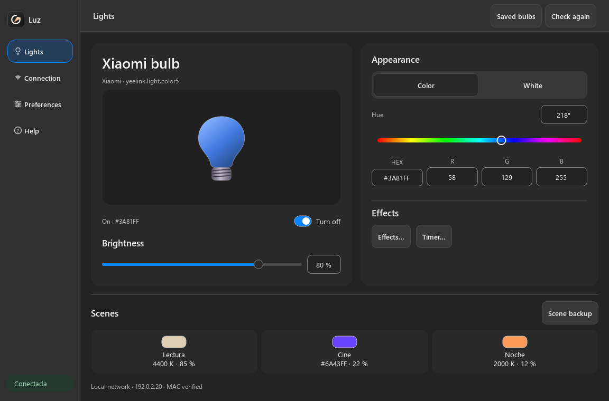

  
  <h1>Luz</h1>
  
Your Xiaomi lights, from your Windows desktop.

  
<a href="https://github.com/adamrz5/Luz/releases/latest"><strong>Download for Windows</strong></a> · <a href="README.es.md">Español</a> · <a href="docs/REFERENCE.md">Documentation</a>

Control supported Xiaomi and Yeelight Wi-Fi bulbs over your local network. Set the mood, save a scene and keep your lights within reach—even while Luz is in the system tray.

## What you can do

- Adjust brightness, RGB/HEX color and white temperature with a live preview.
- Save three scenes; edit, rename, reset or export them.
- Manage saved bulbs and rooms, with shared lighting settings.
- Control power and scenes from the tray or customizable global shortcuts.
- Choose light or dark mode, in English or Spanish.

## Get started

**Windows x64 · Windows 10 1809 or later · No Python installation needed.**

1. Download the `.exe` installer from [Releases](https://github.com/adamrz5/Luz/releases/latest) and install Luz.
2. Add your bulb to Wi-Fi using **Xiaomi Home**. Keep your PC on the same local network.
3. In Luz, open **Connection → Get token by QR**, select your Xiaomi Home region and generate a QR code.
4. Scan it with Xiaomi Home, approve access and select your bulb.
5. Select **Verify and save**. Luz checks the device before saving its credentials.

Manual IP/token entry is also available. To add another bulb later, choose **Connection → Add bulb**. The setup guide stays available under **Help → Help**.

> The installer is unsigned. Windows may show an unknown-publisher warning. Check its SHA-256 against `SHA256SUMS.txt` from the same release.

## Compatibility

**Physically tested:** Xiaomi Mi Smart LED Bulb Essential (**MJDPL01YL**, `yeelink.light.color5`).

Other supported miIO models have controller and simulated-test coverage; they have not all been tested with physical bulbs. Check **Help → Compatible models** or the [compatibility table](docs/REFERENCE.md#compatible-bulbs). Bluetooth, Zigbee, Matter and gateway-only bulbs are not supported by this transport.

## Shortcuts

Control power and scenes with global shortcuts; customize them in **Preferences**. See **Help → Shortcuts** for defaults and status, or the [shortcut guide](docs/REFERENCE.md#everyday-controls).

## Privacy

Lighting commands run locally through miIO. Xiaomi cloud access is used only when you request QR setup. Selected tokens are saved with **Windows DPAPI** encryption; cloud-session credentials remain in memory and are cleared when the worker finishes. Local labels do not rename devices in Xiaomi Home.

Uninstalling preserves your data. After reinstalling Windows, obtain the token again: DPAPI credentials belong to the Windows user who saved them. See [storage and protocol limitations](docs/REFERENCE.md#privacy-and-state).

## Development

Requires Windows x64 and Python 3.11. Follow the [source setup guide](docs/REFERENCE.md#development).

Run the safe tests with `.\.venv\Scripts\python.exe -B tests/ejecutar-seguras.py`. They use temporary state and do not control a real bulb.

[Architecture](docs/REFERENCE.md#architecture) · [Build and sign](docs/REFERENCE.md#building-and-signing) · [Windows CI](https://github.com/adamrz5/Luz/actions) · [Validation limits](docs/REFERENCE.md#validation-and-limitations)

[Report a bug](https://github.com/adamrz5/Luz/issues) with your bulb model, Windows version and reproduction steps. Never share tokens or account credentials. For code changes, keep the scope focused and run the safe tests.

## License

[GPL-3.0](LICENSE) · Created by [adamrz5](https://github.com/adamrz5).

Built with [python-miio](https://github.com/rytilahti/python-miio), [PySide6](https://doc.qt.io/qtforpython-6/) and the community [Xiaomi Cloud Tokens Extractor](https://github.com/PiotrMachowski/Xiaomi-cloud-tokens-extractor). See [third-party licenses and credits](docs/REFERENCE.md#license-and-credits).
