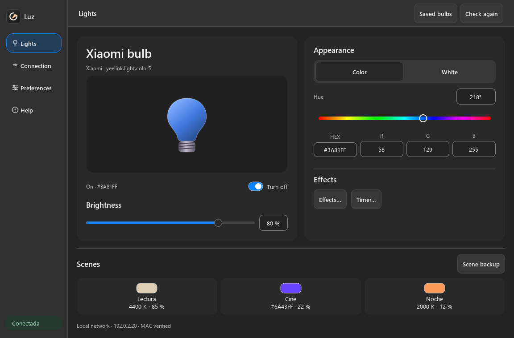
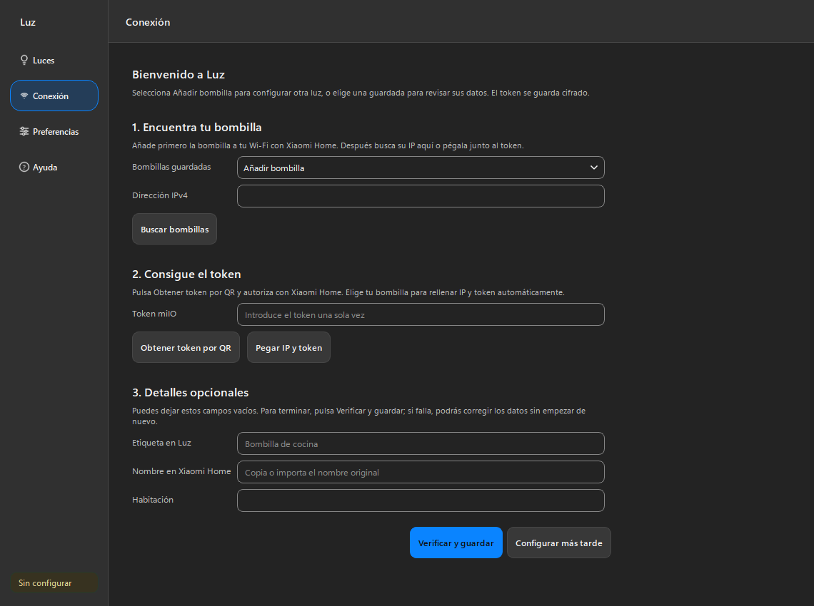
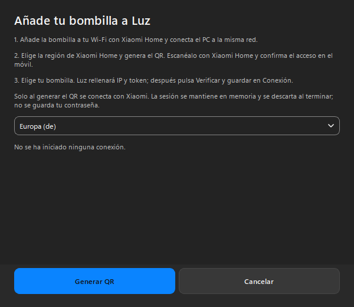
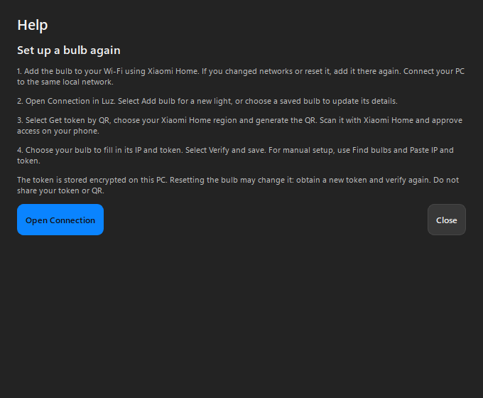

# Project reference

[Back to README](../README.md). Commands and inline paths below are relative to the repository root. Historical validation notes describe their original version, not a guarantee for every device.

  
  <h1>Luz</h1>
  
A Windows desktop app for Xiaomi smart bulbs.

  
<a href="REFERENCE.md">English</a> · <a href="REFERENCE.es.md">Español</a> · <a href="https://github.com/adamrz5/Luz/releases/latest">Download for Windows</a>

  
<strong>Local control · Saved scenes · Global shortcuts · English & Spanish</strong>

  <a href="#getting-started">Get started</a> ·
  <a href="#compatible-bulbs">Compatibility</a> ·
  <a href="#development">Development</a> ·
  <a href="#building-and-signing">Build & sign</a>

Luz controls supported Xiaomi and Yeelight Wi-Fi bulbs over the local network using miIO. Adjust color, white temperature and brightness, save three scenes, and use Windows shortcuts while the app stays in the system tray.

The physically tested device is the **Xiaomi Mi Smart LED Bulb Essential, MJDPL01YL**, identified as **yeelink.light.color5**. Other listed models have controller or simulated-test coverage.

## Features

The setup instructions remain available in **Connection**, even after saving a bulb. To add a newly purchased bulb, select **Add bulb**, follow **Get token by QR**, then **Verify and save**. Existing saved bulbs are kept.

- **Precise lighting controls** with a hue strip, HEX/RGB fields, white temperature and exact brightness.
- **Immediate preview** while dragging. Clicking the drawn bulb toggles power.
- **Three scenes** with combined color and brightness editing, renaming, reset, import and export.
- **Saved bulbs and rooms**, with color or white settings applied to a room or all profiles.
- **Global shortcuts** with live feedback showing the last press and whether its command is pending, applied or failed.
- **Windows tray controls** for power and scenes, optional startup with Windows and quiet connection checks roughly once a minute.
- **Light and dark themes**, English and Spanish.

Luz reads the device state after power, brightness, color, white and scene changes. A mismatched result is reported as an unapplied change. A supported tray command can retry a failed connection.

## Getting started

### Run a Windows build

Download **[Luz for Windows x64](https://github.com/adamrz5/Luz/releases/latest)** from [Releases](https://github.com/adamrz5/Luz/releases/latest). Run the installer; Python is not required. It installs for the current Windows user and creates a Start menu shortcut. Windows 10 version 1809 or later is required.

**The installer is unsigned.** Windows may show an unknown-publisher or SmartScreen warning. Verify its SHA-256 checksum against `SHA256SUMS.txt` from the same release before running it. See [Building and signing](#building-and-signing) to build from source.

The repository contains source, tests, build recipes and documentation. Personal state, virtual environments, generated builds and local audit outputs are excluded. A local development copy may also have an ignored `app/Luz.exe`; keep its `_internal` directory beside it.

### Connect a bulb

Luz opens a guided **Connection** screen automatically when no token is saved. It explains how to find the bulb, obtain and paste its token, and verify the connection. **Set up later** leaves without saving. Once a token is configured, the app opens normally; an offline bulb does not restart the guide.

The guide preserves an already open form, prevents navigation or Escape from cancelling an active verification, releases the QR dialog after closing it and cancels its cloud worker. No cloud work starts until Generate QR is selected.

**First launch, without saved credentials.** This is a real Windows capture with an empty temporary profile, using the Spanish interface. The window is expanded to show the complete form; smaller windows scroll vertically.

**Get token by QR** opens the integrated assistant. It reuses the bundled community extractor, displays the QR inside Luz and queries compatible bulbs after you authorize with Xiaomi Home. No additional executable, browser or local web server is needed.

1. Add the bulb to your home Wi-Fi using Xiaomi Home.
2. Open **Connection** in Luz.
3. Select **Get token by QR**, choose the same region as Xiaomi Home and select **Generate QR**.
4. Scan the QR with Xiaomi Home and approve access on your phone.
5. Choose a compatible bulb. Luz fills in its IP, masked token and Xiaomi Home name.
6. Review the IP and select **Verify and save**. Optionally add a local label and room.

Manual IP/token entry, clipboard import and local bulb discovery remain available. If a bulb has no local IP or uses an unsupported protocol, it does not appear in the QR results.

Discovery identifies candidates. Saving a profile requires an authenticated identity and state check.

The QR adapter reuses [Xiaomi Cloud Tokens Extractor](https://github.com/PiotrMachowski/Xiaomi-cloud-tokens-extractor). Its module is loaded on demand without parsing Luz arguments, opening a terminal or starting the extractor's HTTP server. A separate cancellable worker handles HTTPS; the normal app startup and local lighting commands do not depend on this worker.

The QR session, account cookies and cloud login secrets remain in memory and are cleared when the worker finishes. Only the bulb token selected by the user is saved, encrypted with DPAPI, after the normal local identity/state verification. Cancel closes the dialog immediately; a running HTTPS request finishes within its configured network timeouts. This is a community integration with Xiaomi endpoints, so account policies and server changes can affect login.

The standalone CLI remains available through `tools/Obtener-Token.cmd` for developers, but regular users do not need to download or run it separately.

A local label affects Luz. The Xiaomi Home name field stores a copied or imported name and is not synchronized back to Xiaomi Home.

### Shortcuts and setup help

The **Help** page has separate **Shortcuts** and **Help** entries. Shortcuts shows your saved key combinations and their status. Help provides a short guide to adding or setting up a bulb again: Xiaomi Home, Wi-Fi, region, QR, IP, token and **Verify and save**. Choose **Open Connection** to follow the steps without removing saved bulbs. Both sections are available in English and Spanish and follow the language selected in Preferences.

### Everyday controls

| Action | Default shortcut |
| --- | --- |
| Toggle power | Ctrl + Alt + F5 |
| Apply scene 1 / 2 / 3 | Ctrl + Alt + F6 / F7 / F8 |
| Increase / decrease brightness | Ctrl + Alt + 8 / 9 |
| Increase / decrease white temperature | Ctrl + Alt + F9 / F10 |
| Toggle fullscreen | F11 |
| Leave fullscreen or cancel scene editing | Esc |

Brightness shortcuts use the top number row. Custom shortcuts containing Num require a numeric keypad. Reassign combinations in **Preferences** when another program uses them.

Right-click a scene and select **Edit scene** to adjust color or white temperature and brightness. **Save scene** persists and applies the draft. **Cancel** discards it. **Reset** restores White, 4000 K and 100% brightness after confirmation.

Closing normally keeps Luz in the tray when that preference is enabled. Use **Exit** in the tray menu to stop it. Saving a different language automatically restarts Luz and opens the interface in the selected language. Saved bulbs, encrypted tokens, scenes and other preferences are preserved. Finish any pending command or scene edit before changing languages. If restarting fails, Luz stays open and asks you to close and reopen it.

## Compatible bulbs

The suffixes below belong to `yeelink.light.`.

| Suffix | Controls | Validation |
| --- | --- | --- |
| `color5` | Power, brightness, RGB, tunable white, selected effects and timer | MJDPL01YL physically tested |
| `color`, `color1`, `color2`, `color3`, `color4`, `color7`, `colorc` | Power, brightness, RGB, tunable white | Controller specifications and simulated checks |
| `ct_bulb`, `ct2` | Power, brightness, tunable white | Controller specifications and simulated checks |
| `mono1`, `mono5`, `monob` | Power, brightness | Controller specifications and simulated checks |

**Help → Compatible models** shows the model catalog and evidence. Firmware and local-network access affect compatibility. Bluetooth, Zigbee, Matter and gateway-only bulbs require additional protocols.

The tested Essential responds through miIO. Three Yeelight TCP connection attempts timed out while authenticated miIO reads succeeded. Yeelight LAN compatibility remains unconfirmed for that configuration.

## Privacy and state

- Tokens are encrypted with **Windows DPAPI** for the current user. Current profiles additionally bind encryption to the bulb's MAC and model.
- Profiles and scenes are validated and written atomically.
- Discovery candidates are authenticated before adoption.
- A worker thread serializes network commands. Slider changes are coalesced.
- Background checks use a coarse one-minute timer. Unchanged replies preserve feedback and avoid rendering the controls again.
- Bounded diagnostic logs use predefined events. Exports redact network identifiers. Review reports before sharing.
- Scene backups contain scene values and names.

miIO uses a shared token and does not provide TLS. Luz checks response origin, identity, request ID and timestamp. These checks do not alter the bulb firmware's replay protections. Clipboard import clears the current clipboard, but Windows history or synchronization may retain an earlier copy.

| Location | Purpose |
| --- | --- |
| `config/` | State for the development checkout and its adjacent `app/` |
| `%LOCALAPPDATA%/Luz` | State for separately distributed or installed builds |
| `LUZ_STATE_DIR` | Absolute state-directory override for isolated tests |

State includes `bombilla.json`, `escenas.json`, `preferencias.ini`, bounded logs and instance locks. Legacy `bombilla-token.dpapi` and `bombilla-ip.txt` remain supported.

DPAPI credentials belong to the Windows user who saved them. After reinstalling Windows, enter the token again and import a scene backup if needed. Uninstalling preserves user data.

## Development

Use Windows x64 and Python 3.11. Dependencies are pinned in [requirements.txt](../requirements.txt).

~~~powershell
py -3.11 -m venv .venv
.\.venv\Scripts\python.exe -m pip install -r requirements.txt
.\.venv\Scripts\pythonw.exe src/Bombilla.pyw
~~~

### Tests

~~~powershell
.\.venv\Scripts\python.exe -B tests/ejecutar-seguras.py
~~~

The 25 safe suites use temporary state, Qt offscreen rendering and loopback-only Python networking. They cover first-run guidance, DPAPI, legacy data, profiles, scenes, layout, shortcuts, discovery, packet validation, malformed input, atomic writes and recovery.

Fault tests exercise delayed replies, incorrect identity, invalid tokens, stale messages, lost acknowledgements and a simulated bulb that accepts a brightness command without applying it.

[Windows CI](../.github/workflows/ci.yml) runs the safe suites, builds the installer and verifies installation, native window startup, normal closure and uninstallation. Tests use isolated state and never need a real bulb or Xiaomi account. Local performance recordings, screenshot generators and hardware-specific test scripts are not part of the public source snapshot.

### Architecture

| Component | Responsibility |
| --- | --- |
| [Bombilla.pyw](../src/Bombilla.pyw) | Qt interface, preview, scene drafts, command queue and worker coordination |
| [BombillaLocal.py](../src/BombillaLocal.py) | miIO transport, identity, capabilities, profiles, DPAPI and IP recovery |
| [Escritorio.py](../src/Escritorio.py) | Preferences, Windows shortcuts and startup integration |
| [Escenas.py](../src/Escenas.py) | Scene validation, backups and atomic persistence |
| [Diagnostico.py](../src/Diagnostico.py) | Bounded logging and redacted exports |
| [XiaomiCloud.py](../src/XiaomiCloud.py) | On-demand extractor adapter, bounded HTTPS, cancellation and compatible bulb filtering |
| [TokenXiaomi.py](../src/TokenXiaomi.py) | Native QR assistant, temporary results and selection |
| [Idioma.py](../src/Idioma.py) | Spanish source strings and English translations |
| [Tema.py](../src/Tema.py) | Colors, typography, focus, motion and Windows appearance |
| [build/](../build/) | PyInstaller recipe, Inno Setup installer and icon |
| [tools/](../tools/) | Console control, diagnosis, token extractor and release utilities |
| [tests/](../tests/) | Isolated regression suites and packaged startup check |
| [assets/](../assets/) | Brand artwork and product screenshot |

Confirmed device state, immediate preview and saved scenes are separate values. Edits update the preview immediately. The network worker returns state through Qt signals. A newly added bulb learns its own authenticated device ID.

### Contributing and reporting problems

Keep changes focused and run the safe suites. Report the bulb model, Windows version, reproduction steps and expected behavior. Attach a reviewed, redacted diagnostic report when useful. Keep tokens, account credentials and personal state out of issues and commits.

## Building and signing

Install **Inno Setup 6** for the current Windows user. Run the release builder from PowerShell.

~~~powershell
.\tools\Build-Release.ps1
~~~

It runs the safe suites, packages and checks the application, compiles the installer and writes its SHA-256 checksum.

| Generated path | Contents |
| --- | --- |
| `build/ensayo/app/` | Application folder and Qt runtime |
| `build/distribucion/Luz-instalador.exe` | Windows installer |
| `build/distribucion/SHA256SUMS.txt` | Installer checksum |
| `build/cache/` | Regenerable PyInstaller work files |

Generated output is excluded from Git. The everyday executable remains `app/Luz.exe`.

### Trusted Windows signing

A signed release requires Windows SDK signing tools and a current, trusted code-signing certificate with a private key in the current user's certificate store.

~~~powershell
.\tools\Build-Release.ps1 -CertificateThumbprint YOUR_CERTIFICATE_THUMBPRINT
~~~

This signs the app, installer, uninstaller and Inno Setup self-copies using SHA-256 and timestamping. Private certificate files are excluded from Git. The signer rejects self-signed, expired and untrusted certificates.

A self-signed certificate does not establish a verified publisher on another computer. A valid signature also cannot guarantee immediate SmartScreen reputation. See [Microsoft's guidance](https://learn.microsoft.com/en-us/windows/apps/package-and-deploy/smartscreen-reputation).

Release 1.0.0 is unsigned. Production signing remains pending a trusted certificate.

### Portable build

~~~powershell
.\.venv\Scripts\python.exe -m PyInstaller --noconfirm build/Luz.spec --distpath build/distribucion --workpath build/cache-portatil -- --portatil
~~~

The one-file edition extracts its runtime into a temporary directory. Preserve the entire application folder when distributing the regular build.

## Automated Windows installer validation

GitHub Actions builds the application and Inno Setup installer in the `verify` job. A separate Windows runner downloads that installer, verifies its SHA-256 checksum, installs it, waits for the Luz window, closes it normally and uninstalls it. The installed application runs with Python removed from `PATH` and an isolated empty data directory. Both the installer and JSON test report are workflow artifacts.

Release validation includes 25 safe suites and independent Windows installer checks. The installer checksum was also verified locally. Current public runs are available under [Actions](https://github.com/adamrz5/Luz/actions).

The hosted Windows image includes preinstalled system software. This checks an independent installation without project dependencies, but does not replace testing on a pristine Windows installation. Workflow artifacts contain no saved bulb profiles or tokens.

The bundled token extractor bounds all cloud HTTP requests. Failed QR polling returns cleanly after timeout, connection errors or an unsuccessful HTTP response instead of crashing or retrying indefinitely. Tests use synthetic responses without a Xiaomi account.

Redirected state directories are normalized before creating file paths so Windows short-name aliases and their resolved paths identify the same data directory.

Diagnostic exports refuse the desktop instance-lock path as well as credential, profile and preferences files. A regression test checks that exporting cannot replace that lock.

### First-run review and revalidation

Build, test and installer validation runs are available in [GitHub Actions](https://github.com/adamrz5/Luz/actions).

The application flows were reviewed together with their callers: the deferred startup callback, page navigation and Escape, the guided Connection form, verification callbacks, QR help lifetime, translations, tests and release version values. Version 1.0.0 adds the integrated QR worker and dialog while retaining local verification and the existing setup safeguards.

| Case | Expected behavior checked |
| --- | --- |
| Empty profile, Spanish / English | One guide opens with translated instructions and a masked token field |
| Clipboard import | IP, token and copied name reach the form; the imported clipboard is cleared |
| Invalid or failed verification | The form remains open and retains entered values for retry |
| Successful verification | The active bulb and token are adopted and the guide closes |
| Deferred setup / existing token | Deferral leaves without saving; an existing token prevents automatic guidance |
| Hidden startup / shutdown / another open page | Guidance does not interrupt these states |
| Navigation or Escape during verification | The pending form stays open and navigation selection remains consistent |
| Integrated QR | No network on opening the dialog; generation, image limits, cancellation, bilingual selection and field import are covered with synthetic responses |
| Cloud session | HTTPS domain checks, redirect checks, response-size limits, model filtering, redacted errors and cookie cleanup are covered |

The full safe battery contains 25 suites. Captures use the native Windows Qt platform, empty temporary state and no real bulb credentials. The minimum window size was also checked for horizontal overflow. Live unauthenticated QR generation and cancellation have also been checked. Mobile approval with a real Xiaomi account and retrieval of its bulb list remain unverified because the user could not complete that step during validation. Screenshots never contain an active authorization QR. Clean Windows installation remains a separate limitation.

## Validation and limitations

The Essential has been used to verify power, brightness, RGB, white temperature, shortcuts, a selected effect, preview clicks and rapid mixed commands. With 200 ms of added delay, brightness and color changes followed by power-off reached the expected final state.

Controller-injected communication failures recovered through authenticated reads. Physical sessions restored the initial power, brightness and color.

Still to validate:

- Installation and startup on a clean Windows system.
- Recovery after a physical mains-power outage.
- Other bulb models and firmware.
- Groups with several physical bulbs.
- Production signing and SmartScreen behavior on another computer.

## Research references

[python-miio](https://github.com/rytilahti/python-miio) provides the current protocol foundation.
[python-yeelight](https://yeelight.readthedocs.io/en/latest/) documents TCP control and effects.
[yeelight-ctl](https://github.com/vicirdek/yeelight-ctl) provides screen-color synchronization ideas.
[hass-xiaomi-miot](https://github.com/al-one/hass-xiaomi-miot) and [Xiaomi Home](https://github.com/XiaoMi/ha_xiaomi_home) provide model and capability references.

Enabling additional bulb services requires a separate configuration decision.

## License and credits

Copyright © 2026 [adamrz5](https://github.com/adamrz5).

Luz is prepared under the **GNU General Public License v3.0**. See [LICENSE](../LICENSE).

| Component | License / source |
| --- | --- |
| python-miio | GPL-3.0, [source](https://github.com/rytilahti/python-miio) |
| PySide6 and Qt | LGPL-3.0, GPL alternatives or commercial terms, [licensing](https://doc.qt.io/qtforpython-6/licenses.html) |
| Xiaomi Cloud Tokens Extractor | MIT, copyright Piotr Machowski, [included license](../tools/xiaomi-tokens/LICENSE) |

The extractor is a locally adapted copy of [Xiaomi Cloud Tokens Extractor](https://github.com/PiotrMachowski/Xiaomi-cloud-tokens-extractor). Its QR server defaults to loopback and its shell launchers avoid automatic downloads. Python dependencies and Docker support remain in `tools/xiaomi-tokens/`.

The repository presentation takes cues from [PowerToys](https://github.com/microsoft/PowerToys) and [UniGetUI](https://github.com/Devolutions/UniGetUI), using a real product screenshot, concise setup, explicit compatibility and documented release checks.

## Discover and share

GitHub topics describe the actual project: Xiaomi, Yeelight, miIO, local control, Windows, Python and PySide6.

#Xiaomi #Yeelight #SmartLighting #Windows #Python #OpenSource

### Architecture and quality checks in 1.0.0

Version 1.0.0 includes the interface, connectivity, security and distribution corrections documented below.

- Direct Connection/Preferences navigation; newly created forms start at the top, including rapid page switches.
- Vertical forms allocate the required height when rows wrap in smaller windows. Consistent typography and no contrasting square corners.
- Temporary dialogs and menus are released; the Connection token field is cleared on closing.
- QR terminal events are handled before polling stops; cancellation leaves no polling behind and redirects cannot bypass response bounds.
- Luz-owned shortcuts can be swapped without reporting them occupied; superseded pending commands receive a final status.
- Room commands remain available when the selected bulb is offline, so other room lights can still be attempted.
- Authenticated readback confirms effect activity and timer activation/cancellation. Activity does not identify the exact running effect preset.

Architecture: `show_section()` selects the destination before closing the previous form; `mount_section()` configures fonts, width and scroll position. Individual groups retain `QFormLayout`, while Connection uses a vertical outer layout to allocate its actual required height. Cloud QR runs on a separate worker and queue; UI polling stops only after the worker has finished and the queue is empty, or on cancellation. Local control retains the existing miIO identity checks and DPAPI persistence.

Separate agents reviewed architecture, implemented UI fixes, audited the backend, implemented backend fixes and performed the final independent review. Tests use synthetic profiles; public screenshots contain no account data or active QR. On the real Essential bulb, effect start/stop, five- and one-minute timers and cancellation were confirmed; the complete original status was restored and compared. Mobile QR approval and other firmware variants remain unverified.

Final local validation: 24 safe suites passed, 1.0.0 build and installation, installed executable startup, and 16 native bilingual screenshots across two themes and window sizes. Real Windows input verified scrolled Connection → Preferences → Connection with the complete heading restored. The installed brightness-down shortcut changed the bulb from 33% to 23%; its original status was restored and checked. All six configuration files, including the diagnostic log, retained their hashes. Distribution requires the build and installation checks to pass.

#### Second review by domain

Five distinct agents handled UI, logic, security, performance and distribution. The sixth reviewer receives the combined result only after all five finish their corrections.

- UI: visible selections using system high-contrast colors, card stacking based on actual required width, and initial geometry bounded by the work area. Native matrix at 100/125/150/200%, Spanish/English and light/dark/simulated high contrast: 24 contained frames and 48 views without hidden horizontal overflow.
- Logic: commands are rejected during verified profile switching; discrete toggles retain ordering across scenes and adjustments; authenticated active-member replies restore connection status; shutdown skips group members not yet sent.
- Security: scene names invalid for UTF-8 are rejected before importing; persistence failures preserve earlier data. Exports honor the confirmed path and protect internal files. OSV and PyPI returned no advisories for the 37 pinned versions on 21 November 2026; native components and vendored code are not certified. [OSV API](https://google.github.io/osv.dev/post-v1-querybatch/) · [PyPI API](https://docs.pypi.org/api/json/#get-a-release).
- Performance: load the device stack before the PySide6 import hook, without new dependencies. Ten source-startup pairs reduced median first guided paint from 621.3 to 543.3 ms (−12.6%). This is a source measurement, not a promise about the packaged executable. Private committed memory stabilized at 77.51 MiB after 50 reopening rounds. Configured silent checks remain once per minute; hidden CPU was below measurement resolution.
- Distribution: reject any existing installation before disposable installer testing, including custom paths; require a visible window owned by the launched PID; keep test assertions enabled despite environment optimization; derive installer version from `Diagnostico.LUZ_VERSION` and reject an explicit mismatch.

The additional `distribucion` suite tests false positives with simulated processes, windows and registry; it never installs or removes programs. The real startup gate uses native Windows Qt with temporary state. Unit suites retain offscreen Qt and loopback-only networking. Mobile Xiaomi approval, other firmware, mixed-DPI monitor moves and clean-Windows installation remain unverified. Publication follows installer validation and distribution-file review.

Final repeat on the combined source: eight interleaved pairs, median startup 730.77 → 607.86 ms (−16.8%), all favoring the final code. After 50 rounds, counts returned to 178 QObject, 109 widgets and one window; private committed memory stabilized at 65.73 MiB. This was a separate run: do not directly compare its medians or memory to the earlier trial or extrapolate them to the packaged executable.

Local 1.0.0 closure: all five roles finished before the sixth agent's combined review. The reviewer found an additional Power button case with interleaved commands; the logic role fixed it using real Qt clicks, and the same reviewer approved the closure. The full battery passed 25/25 and the distribution pipeline produced a 1.0.0 installer whose executable opens a visible native window. The local installation matches the reviewed build. Five toggles through the installed executable's real shortcut were confirmed on the bulb and its complete original status was restored. All six configuration file hashes were unchanged. Release validation includes these checks. Initial window sizing can affect paint work in the synthetic source measurements; an equivalent packaged-startup improvement has not been measured.

### Language switching fix (1.0.1)

Saving Spanish or English now restarts Luz automatically instead of leaving the previous language on screen. Regression checks cover both directions, pending commands, source and packaged restart arguments, and launch failure. All 25 safe suites passed; the local installer was built and installed, and changing Spanish to English in the installed application opened a new English window. Saved bulb profiles, the encrypted token, IP and scenes retained their hashes. Preferences intentionally changed language and the diagnostic log recorded connection checks.

Selecting a different language shows “Luz will restart to apply the language” above Save; selecting the active language hides the notice again. Saving applies the change through the automatic restart.
